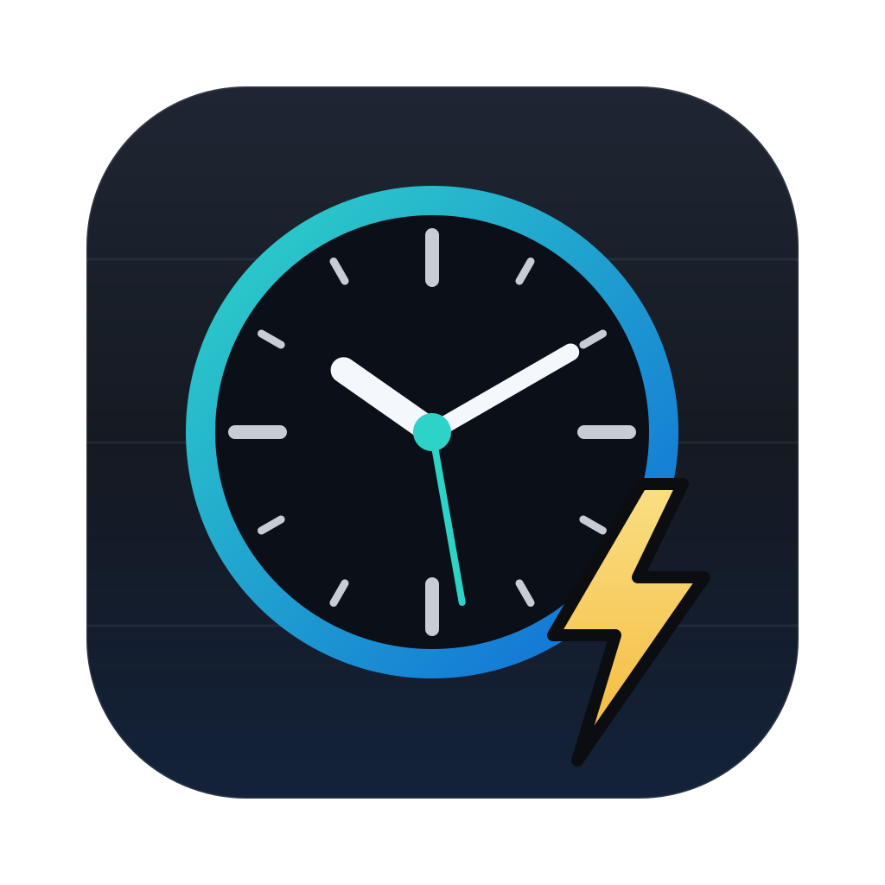

# SimpleDesktopWidget

A desktop widget for macOS: a big, bold clock, a three-day forecast and today's calendar events, floating on the desktop on a soft drop shadow. It sits just above the desktop icons and below every window, on all Spaces.



- **Clock:** 12 or 24-hour, optional seconds, the date, and Zulu (UTC) time in 24-hour format.
- **Forecast:** three days from [Open-Meteo](https://open-meteo.com) (free, no key, worldwide): icon, high/low with a temperature bar, rain amount and chance, wind gusts.
- **Weather alerts (US):** active National Weather Service warnings, watches and advisories for your location, as coloured banners.
- **Nearby lightning (optional):** live strikes within a radius you choose, with distance and direction, from the [Blitzortung.org](https://www.blitzortung.org) volunteer network.
- **Calendar:** today's events from the calendars you pick, with the one happening now highlighted.
- **Looks:** any installed font, clock and text weight, text and background colours, background and whole-display opacity, a text outline (halo) for light text on light wallpaper, drop-shadow strength, size.

Requires macOS 15 (Sequoia) or later. Runs on Apple Silicon and Intel.

## Install

1. Download `SimpleDesktopWidget-<version>.dmg` from [Releases](../../releases) and open it.
2. Drag **SimpleDesktopWidget** to **Applications**.
3. Open it. The app is free and isn't notarised by Apple, so the first time macOS says it can't verify it. Click **Done**, then go to **System Settings → Privacy & Security**, scroll down and click **Open Anyway** next to SimpleDesktopWidget. Or, in Terminal, once:

   ```
   xattr -dr com.apple.quarantine /Applications/SimpleDesktopWidget.app
   ```

On first launch the settings window opens and macOS asks for calendar access. Set your location under **Weather** (search for a town, or use your current location), drag the widget where you want it and click **Done**.

The clock icon in the menu bar (or right-clicking the widget) has **Configure Widget…**, **Refresh Now** and **Quit**. **Start at login** is under General.

## Permissions

| Permission | Used for | Asked when |
| --- | --- | --- |
| Calendars | Today's events | First launch |
| Location | "Use my current location" | Only if you click it |
| Screen Recording | **Frosted glass**: a blurred copy of the wallpaper behind the widget, which also hides desktop icons under it. Only the system wallpaper layer is captured, never icons or windows. | Only if you turn it on |
| Automation (Finder) | **Move desktop icons out of the widget's way**: icons under the widget are moved to the nearest free spot. Needs Finder's desktop **Sort By** set to **None**. | Only if you turn it on |

Because the app is signed ad hoc, macOS may ask again for these after an update.

## Data sources

- Forecast: [Open-Meteo](https://open-meteo.com), [CC BY 4.0](https://creativecommons.org/licenses/by/4.0/). Checked every 30 minutes.
- Alerts: [National Weather Service](https://www.weather.gov/documentation/services-web-api) API, US only. Checked every 5 minutes.
- Lightning: [Blitzortung.org](https://www.blitzortung.org), a community network; its data is for private, non-commercial use. The widget receives the worldwide strike stream and filters it on your Mac, so your location isn't sent. Off by default. **Not for safety decisions.**

Your location goes to Open-Meteo and the NWS only to fetch the forecast and alerts for it. Settings stay on your Mac (`defaults read com.kingsqueak.SimpleDesktopWidget`).

## Build

Swift package, AppKit + SwiftUI; Xcode command-line tools.

```
./build.sh            # build/SimpleDesktopWidget.app (universal)
./build.sh install    # also copies it to ~/Applications and restarts it
./build.sh dmg        # also makes build/SimpleDesktopWidget-<version>.dmg
```

The version is in `VERSION`. The icon is generated by `scripts/make-icon.py`. Pushing a `v*` tag builds the DMG on GitHub Actions.

## License

GPL-3.0-or-later. © 2026 KC2RGW Chris. See [LICENSE](LICENSE).
